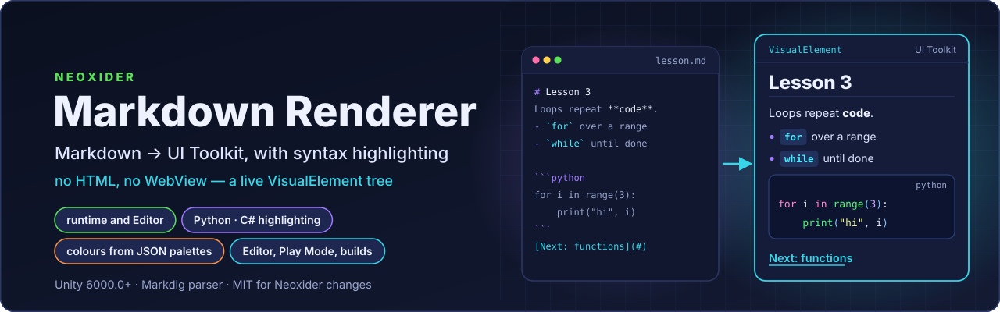

<p align="center">
  
</p>

#  Neoxider Markdown Renderer

**Markdig-based Markdown renderer for Unity UI Toolkit.** Turns Markdown text into a live `VisualElement`
tree — no HTML or WebView — so it can sit in any runtime UI (chat bubbles, quiz text, docs panels) or power
Editor tools.

[](https://unity.com/releases/editor)
[](#license)
[](CHANGELOG.md)

<sub>
<a href="#why">Why</a>&nbsp;&nbsp;•&nbsp;
<a href="#what-is-inside">What is inside</a>&nbsp;&nbsp;•&nbsp;
<a href="#install">Install</a>&nbsp;&nbsp;•&nbsp;
<a href="#quick-start">Quick start</a>&nbsp;&nbsp;•&nbsp;
<a href="#syntax-highlighting">Highlighting</a>&nbsp;&nbsp;•&nbsp;
<a href="#styling">Styling</a>&nbsp;&nbsp;•&nbsp;
<a href="#editor-tooling">Editor</a>&nbsp;&nbsp;•&nbsp;
<a href="#limits">Limits</a>&nbsp;&nbsp;•&nbsp;
<a href="#license">License</a>
</sub>

---

## Why

Chat replies, lesson text and in-project docs are usually written in Markdown, but UI Toolkit has no
built-in Markdown element. This package parses Markdown with Markdig and builds native UI Toolkit
elements from it, so the text lives inside your own panel, takes your USS, reports link clicks to your
code, and colours code blocks from a JSON palette instead of hard-coded colours.

---

## What is inside

- **`UIMarkdownRenderer`** — headings, bold/italic, inline code, blockquotes, nested lists, links, thematic
  breaks and fenced code blocks with syntax highlighting (Python, C#).
- **`MarkdownDisplay`** (`[UxmlElement]`) — ready-to-use runtime control: drop it into UXML or create it in
  code, set `Markdown` / `SourceAsset`. Its stylesheet is a serialized reference, so it renders the same in
  the Editor, Play Mode and builds (WebGL, standalone).
- **`VideoPlayerElement`** (`[UxmlElement]`) — inline video embeds.
- **`YamlFrontMatterHandler`** — optional YAML front matter ahead of the Markdown body.
- **Syntax highlighting** — `PythonSyntaxHighlighter`, `CSharpSyntaxHighlighter`; colours come from JSON
  palettes, not from code.
- **Editor tooling** — rendered inspector for `.md` assets, Markdown Doc Viewer, Markdown Preview, media
  pop-out window.
- **Default styles** `Styles/MarkdownRenderer.uss` and `Styles/Quiz.uss` — optional.
- **`Examples/*.md`** — sample documents.

---

## Install

Unity **6000.0** or newer. Package Manager → *Add package from git URL*:

```text
https://github.com/NeoXider/NeoxiderMarkdownRenderer.git#v1.2.1
```

or in `Packages/manifest.json`:

```json
"com.neoxider.markdownrenderer": "https://github.com/NeoXider/NeoxiderMarkdownRenderer.git#v1.2.1"
```

`package.json` declares no dependencies: the Markdig parser is vendored under `Runtime/Markdig`.

---

## Quick start

The namespace and the renderer class share the name `UIMarkdownRenderer`, so refer to the class through an
alias (or `global::UIMarkdownRenderer.UIMarkdownRenderer`):

```csharp
using UIMarkdownRenderer;
using UnityEngine;
using MarkdownRenderer = UIMarkdownRenderer.UIMarkdownRenderer;

var renderer = new MarkdownRenderer((link, r) => Application.OpenURL(link));
renderer.SetMarkdown("# Hello\n\nSome **markdown**.");
myVisualElement.Add(renderer.RootElement);
```

Or the ready-made control:

```csharp
var display = new MarkdownDisplay { DefaultStyleSheet = myStylesheet };
display.LinkClicked += link => Application.OpenURL(link);
display.SetMarkdown("# Hello\n\nSome **markdown**.");
myVisualElement.Add(display);
```

In UXML, `MarkdownDisplay` exposes the attributes `markdown`, `source-asset`, `default-stylesheet` and
`include-default-stylesheet`.

Per-instance options on the renderer: `InlineCodeColor`, `InlineCodeInheritsTextColor`,
`LinkInheritsTextColor`.

---

## Syntax highlighting

- Fenced blocks tagged `python` / `py` go through `PythonSyntaxHighlighter`, `csharp` / `cs` through
  `CSharpSyntaxHighlighter`.
- Colours come from JSON palettes: `SyntaxPalette.Load(name)` reads `Resources/SyntaxHighlighting/<name>.json`.
  The package ships `python.json`, `python-light.json` and `csharp.json`; a key missing from a palette
  falls back to the VS Code Dark+ colour.
- A highlighter takes its palette in the constructor (`new PythonSyntaxHighlighter(palette)`), and
  `CodeBlockRenderer.ReloadPalette(language, palette)` swaps the palette used by code blocks at runtime,
  for example in a live style preview.

---

## Styling

- `Styles/MarkdownRenderer.uss` and `Styles/Quiz.uss` are defaults, not requirements: render with
  `includeDefaultStylesheet: false` and bring your own theme.
- The default stylesheet is shared by every renderer in the process: the first `MarkdownDisplay` that
  renders with `IncludeDefaultStylesheet` on decides it for the whole app, unless every instance passes its
  own `DefaultStyleSheet`. In a build, either always assign one explicitly or turn the default off and layer
  your own theme.
- `InlineCodeInheritsTextColor` and `LinkInheritsTextColor` drop the `<color>` tag, so inline code and links
  take the text colour from your USS (code stays bold, links stay underlined).

---

## Editor tooling

- Rendered inspector for `.md` assets.
- `Window → Markdown Doc Viewer` — anchors, `Assets/…` / `Packages/…` links, `search:` / `package:`
  lookups, `cmd:` commands.
- `Window → Neoxider → Markdown Preview` — raw text next to the live render.
- Media pop-out window.

---

## Assemblies

| Assembly | Contents |
|---|---|
| `Rtl.MarkdownRenderer.Runtime` | Renderer, `MarkdownDisplay`, highlighters, video element |
| `Rtl.MarkdownRenderer.Editor` | Editor tooling (Editor only) |
| `Markdig` | Vendored Markdown parser |
| `Rtl.MarkdownRenderer.Tests.EditMode` | EditMode tests |

---

## Limits

- **Two highlighted languages.** Only Python and C# fences are coloured; `ReloadPalette` swaps palettes for
  those two, it does not register new languages.
- **No HTML.** Markdown becomes UI Toolkit elements; there is no HTML or WebView rendering path.

---

## Changelog

Release notes: [CHANGELOG.md](CHANGELOG.md) (the latest entries are in Russian).

---

## License

This package is a derivative work, and the licenses apply to different parts of it:

- **Modifications and additions by Neoxider** — [MIT](LICENSE.md), © 2026 Neoxider. The MIT terms cover
  the modifications and additions only; they do not relicense the original work.
- **Original work** — [Markdown UIElement](https://github.com/UnityGuillaume/MarkdownRenderer) by Guillaume
  Saby, © 2023 Unity Technologies. The original parts and the parts derived from them remain under the
  [Unity Companion License](https://unity3d.com/legal/licenses/unity_companion_license) for
  Unity-dependent projects.
- **Markdig** (vendored in `Runtime/Markdig`) — BSD-2-Clause, © Alexandre Mutel; see
  [Third Party Notices.md](Third%20Party%20Notices.md).

Full text: [LICENSE.md](LICENSE.md).

**Author:** [Neoxider](https://github.com/NeoXider) · **Issues:**
[GitHub Issues](https://github.com/NeoXider/NeoxiderMarkdownRenderer/issues)
